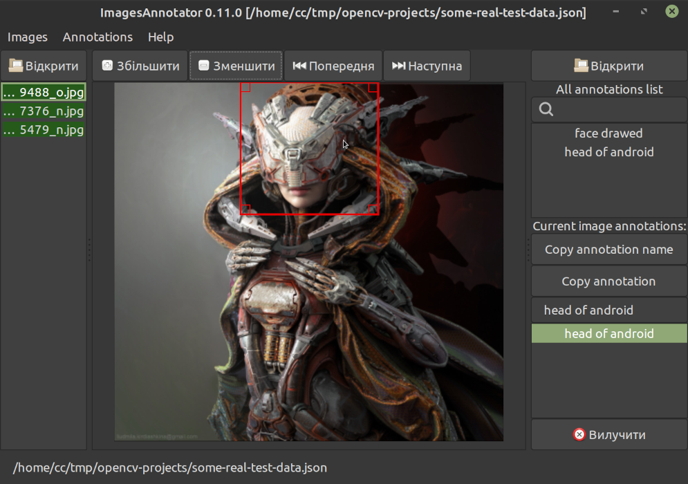
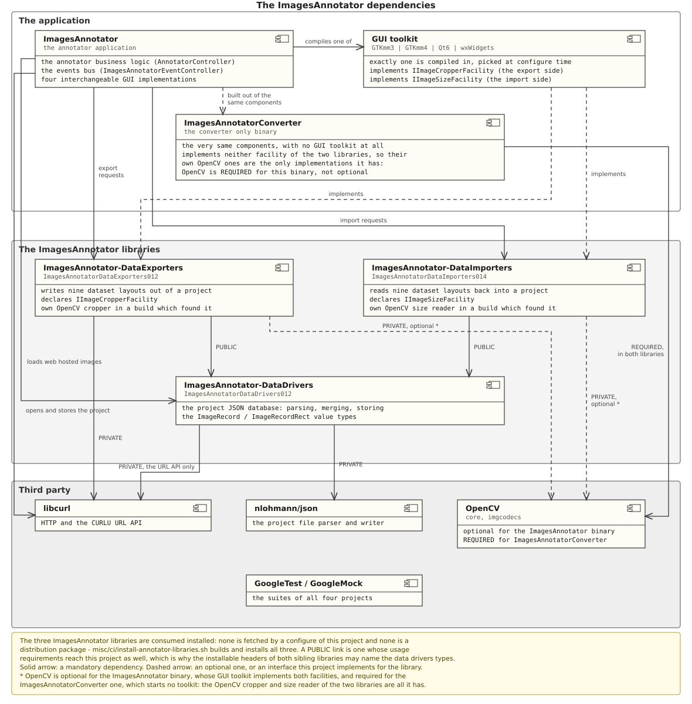

**The images annotator application**

# Goal of the ImagesAnnotator

The goal of the image annotator is to provide information about the provided images' located objects in order to supply annotated data to the learning networks with next load into libraries like [OpenCV](https://github.com/opencv/opencv).

Current project also serves research purposes. So may look a bit over engineered.

Fast started with help of the C++ templated project located at [https://github.com/yuriysydor1991/cpp-app-template](https://github.com/yuriysydor1991/cpp-app-template)

Translations of the current README.md may be found in the `doc` subdirectory:
- [doc/README.uk_UA.md](doc/README.uk_UA.md)

**WARNING! Project is in the alpha stage! Save and backup your data often!**

See more at the [kytok.org.ua](http://www.kytok.org.ua/)

💵 Donate at [http://kytok.org.ua/page/pozertvy](http://kytok.org.ua/page/pozertvy)

# Usage

The main application window looks like next.



On the top located regular menu:

- `Images` to import images directories,
- `Annotations` to manage current project,
- `Help` for help options.

Next in line located buttons to open and append new image containing directory (duplicated functionality from `Images` menu), increase and decrease zoom on the current opened image, the next and previous image if any from the opened images in the queue (left list panel), and finally duplicated button to open already existing annotations DB (currently only internal JSON format is supported).

The images that are listed on the green background on the left panel indicating having at least one annotation.

On the right panel there are list all the annotations in the project list box and the currently opened image annotations only list box. The `Copy annotation name` button designed to copy text from a top list box selected annotation to the current image selected annotation. The `copy annotation` duplicates current selected image annotation. The delete button in the bottom of the current image annotations list designed to delete current image selected annotation respectively.

On the bottom of the window there is a status panel that currently indicates only opened JSON db file.

After annotating the images of interest, use the export submenu of the `Annotations` menu to export data to widely used annotation formats.

A dataset that already exists on the disk goes the other way: the import submenu beside it reads back every one of the nine layouts the export submenu writes - the plain text one, the darknet YOLO v4 one, the three Ultralytics YOLO ones, the COCO and the Create ML JSON ones, the Pascal VOC XML one and the PyTorch Vision one - into the project being edited. The recovered images are appended to the ones already opened - an image the project already holds is kept as it was - so an import may be repeated, and it writes nothing into the directory it reads.

Neither half needs the window at all. Given the `--convert-from`, `--convert-src`, `--convert-to` and `--convert-dst` flags the executable reads a dataset of one format and writes it back in another one without starting any graphical interface, reporting what it prepares and converts through the log messages alone - so a dataset conversion fits a script and a build pipeline. The annotations project of the application itself is one of the formats, beside the nine dataset layouts of the menus. See [Converting the annotations formats](/doc/sections/en_US/6-2-3-converting-the-annotations-formats.md).

# Dependencies

The application is built against three standalone libraries of its own - the
[ImagesAnnotator-DataDrivers](https://github.com/yuriysydor1991/ImagesAnnotator-DataDrivers.git)
annotations project database, the
[ImagesAnnotator-DataExporters](https://github.com/yuriysydor1991/ImagesAnnotator-DataExporters.git)
dataset writers and the
[ImagesAnnotator-DataImporters](https://github.com/yuriysydor1991/ImagesAnnotator-DataImporters.git)
dataset readers - plus one of the four interchangeable GUI toolkits and a small
set of third party libraries:



None of the three own libraries is a distribution package and none is fetched by
a configure of this project, so all three are installed first - the shipped
[misc/ci/install-annotator-libraries.sh](/misc/ci/install-annotator-libraries.sh)
script builds and installs them in one command. See [Enabling the
ImagesAnnotator-DataDrivers library](/doc/sections/en_US/5-36-enabling-the-ImagesAnnotator-DataDrivers-library.md),
[Enabling the ImagesAnnotator-DataExporters
library](/doc/sections/en_US/5-37-enabling-the-ImagesAnnotator-DataExporters-library.md)
and [Enabling the ImagesAnnotator-DataImporters
library](/doc/sections/en_US/5-39-enabling-the-ImagesAnnotator-DataImporters-library.md).

The diagram is rendered from the PlantUML source at
[doc/diagrams/plantuml/dependencies.puml](doc/diagrams/plantuml/dependencies.puml).
Edit that file and render it again whenever a dependency changes:

```
# from the project root directory

plantuml -tsvg -o ../images doc/diagrams/plantuml/dependencies.puml
```

# Implementing custom exporters

Current ImagesAnnotator application stores the annotations database in the `JSON` file format. It makes it easy to implement a custom export script into required format to train neural network with the help of `Python` or `Bash`.

The exporters the application itself ships - the plain text one, the darknet YOLO v4 one, the three Ultralytics YOLO ones - detection, oriented bounding boxes and segmentation - the COCO JSON one, the Pascal VOC XML one, the Create ML JSON one and the PyTorch Vision one - live in the standalone [ImagesAnnotator-DataExporters](https://github.com/yuriysydor1991/ImagesAnnotator-DataExporters.git) library, so a new format may also be added there instead, and every tool built on that library gains it at once. See [Enabling the ImagesAnnotator-DataExporters library](/doc/sections/en_US/5-37-enabling-the-ImagesAnnotator-DataExporters-library.md).

Reading a dataset back is the mirror of that: the nine importers the application ships - one for every layout it exports - live in the standalone [ImagesAnnotator-DataImporters](https://github.com/yuriysydor1991/ImagesAnnotator-DataImporters.git) library. See [Enabling the ImagesAnnotator-DataImporters library](/doc/sections/en_US/5-39-enabling-the-ImagesAnnotator-DataImporters-library.md).

# Documentation contents

**Document is under the refinement**

1. [Cloning the ImagesAnnotator project](/doc/sections/en_US/1-cloning-the-cxx-template-project.md)
1. [Forking and replacing the origin](/doc/sections/en_US/2-forking-and-replacing-the-origin.md)
1. [Requirements](/doc/sections/en_US/3-requirements.md)
    1. [Required tools for the GNU/Linux based OS](/doc/sections/en_US/3-1-required-tools-for-the-GNU-Linux-based-OS.md)
    1. [Required tools for the MS Windows based OS](/doc/sections/en_US/3-2-required-tools-for-the-MS-Windows-based-OS.md)
    1. [Optional for the tests](/doc/sections/en_US/3-3-optional-for-the-tests.md)
    1. [Optional for the documentation](/doc/sections/en_US/3-4-optional-for-the-documentation.md)
    1. [Optional for the code formatting](/doc/sections/en_US/3-5-optional-for-the-code-formatting.md)
    1. [Optional for the code analyzer (cppcheck)](/doc/sections/en_US/3-6-optional-for-the-code-analyzer-cppcheck.md)
    1. [Optional for the code analyzer with clang-tidy](/doc/sections/en_US/3-7-optional-for-the-code-analyzer-with-clang-tidy.md)
    1. [Optional for the memory check with Valgrind](/doc/sections/en_US/3-8-optional-for-the-memory-checkwith-Valgrind.md)
    1. [Optional for the flatpak packager](/doc/sections/en_US/3-9-optional-for-the-flatpak-packager.md)
    1. [Optional for the Docker container runs](/doc/sections/en_US/3-10-optional-for-docker-container-runs.md)
    1. [Optional for the snap packager](/doc/sections/en_US/3-11-optional-for-snap-packager.md)
1. [Project structure](/doc/sections/en_US/4-project-structure.md)
    1. [Implement code straight away!](/doc/sections/en_US/4-1-implement-code-straight-away.md)
    1. [Changing the project and executable name](/doc/sections/en_US/4-2-changing-the-project-and-executable-name.md)
    1. [Version tracking and other project parameters](/doc/sections/en_US/4-3-version-tracking-and-other-project-parameters.md)
    1. [Minimal possible versions](/doc/sections/en_US/4-6-minimal-possible-versions.md)
    1. [Project tests](/doc/sections/en_US/4-4-project-tests.md)
        1. [Google Test](/doc/sections/en_US/4-4-1-google-test.md)
    1. [Extensions](/doc/sections/en_US/4-5-extensions.md)
1. [Project build](/doc/sections/en_US/5-project-build.md)
    1. [IDE build](/doc/sections/en_US/5-1-IDE-build.md)
    1. [Command line build](/doc/sections/en_US/5-2-command-line-build.md)
    1. Enabling testing
        1. [Enabling unit and component testing](/doc/sections/en_US/5-3-1-enabling-unit-testing.md)
        1. [Disabling system GTest probe](/doc/sections/en_US/5-3-2-disabling-system-GTest-probe.md)
    1. [Documentation build](/doc/sections/en_US/5-4-documentation-build.md)
    1. [Configuring the documentation install support](/doc/sections/en_US/5-5-configuring-the-documentation-install-support.md)
    1. [Enabling and performing code formatting target](/doc/sections/en_US/5-6-enabling-and-performing-code-formatting-target.md)
    1. [Enabling the static code analyzer target with cppcheck](/doc/sections/en_US/5-7-enabling-the-static-code-analyzer-target-with-cppcheck.md)
    1. [Enabling the static code analyzer with clang-tidy](/doc/sections/en_US/5-8-enabling-static-code-analyzer-with-clang-tidy.md)
    1. [Enabling the dynamic memory check target with valgrind](/doc/sections/en_US/5-9-enabling-the-dynamic-memory-check-target-with-valgrind.md)
    1. [Enabling DEB package generation with cpack](/doc/sections/en_US/5-10-enabling-DEB-package-generation-with-cpack.md)
    1. [Enabling the flatpak package generation support](/doc/sections/en_US/5-11-enabling-the-flatpak-package-generation-support.md)
    1. [Enabling the Docker container build and run](/doc/sections/en_US/5-12-enabling-the-docker-container-build-and-run.md)
    1. [Enabling sanitizers](/doc/sections/en_US/5-13-enabling-sanitizers.md)
    1. [Enabling the libcurl](/doc/sections/en_US/5-14-enabling-libcurl.md)
    1. [Enabling gprof profiler analysis](/doc/sections/en_US/5-15-enabling-gprof-profiler-analysis.md)
    1. [Enabling vagrind's callgrind profiler analysis](/doc/sections/en_US/5-16-enabling-valgrinds-callgrind-profiler-analysis.md)
    1. [Enabling Jenkins pipeline inside Docker container](/doc/sections/en_US/5-17-enabling-Jenkins-pipeline-inside-Docker-container.md)
    1. [Enabling the nlohmann json library](/doc/sections/en_US/5-18-enabling-the-nlohmann-json-library.md)
    1. [Enabling the snap packager](/doc/sections/en_US/5-19-enabling-the-snap-package-manager.md)
    1. [Enabling FreeBSD pkg package generation with cpack](/doc/sections/en_US/5-20-enabling-FreeBSD-pkg-package-generation-with-cpack.md)
    1. [Enabling WIX MSI package generation with cpack](/doc/sections/en_US/5-21-enabling-WIX-MSI-package-generation-with-cpack.md)
    1. [Enabling RPM package generation with cpack](/doc/sections/en_US/5-22-enabling-RPM-package-generation-with-cpack.md)
    1. [Enabling the zlib library](/doc/sections/en_US/5-23-enabling-the-zlib-library.md)
    1. [Enabling the libpng library](/doc/sections/en_US/5-24-enabling-the-libpng-library.md)
    1. [Enabling the libjpeg library](/doc/sections/en_US/5-25-enabling-the-libjpeg-library.md)
    1. [Enabling the libwebp library](/doc/sections/en_US/5-26-enabling-the-libwebp-library.md)
    1. [Enabling the lunasvg library (SVG)](/doc/sections/en_US/5-27-enabling-the-lunasvg-library.md)
    1. [Enabling the giflib library (GIF)](/doc/sections/en_US/5-28-enabling-the-giflib-library.md)
    1. [Enabling the libtiff library (TIFF)](/doc/sections/en_US/5-29-enabling-the-libtiff-library.md)
    1. [Enabling the OpenEXR library (EXR / HDR)](/doc/sections/en_US/5-30-enabling-the-openexr-library.md)
    1. [Enabling the OpenJPEG library (JPEG 2000)](/doc/sections/en_US/5-31-enabling-the-openjpeg-library.md)
    1. [Enabling the libavif library (AVIF)](/doc/sections/en_US/5-32-enabling-the-libavif-library.md)
    1. [Enabling the libheif library (HEIF/HEIC)](/doc/sections/en_US/5-33-enabling-the-libheif-library.md)
    1. [Continuous integration with GitHub Actions](/doc/sections/en_US/5-34-continuous-integration-with-GitHub-Actions.md)
    1. [Continuous integration with GitLab CI/CD](/doc/sections/en_US/5-35-continuous-integration-with-GitLab-CI.md)
    1. [Enabling the ImagesAnnotator-DataDrivers library](/doc/sections/en_US/5-36-enabling-the-ImagesAnnotator-DataDrivers-library.md)
    1. [Enabling the ImagesAnnotator-DataExporters library](/doc/sections/en_US/5-37-enabling-the-ImagesAnnotator-DataExporters-library.md)
    1. [Quick build scripts](/doc/sections/en_US/5-38-quick-build-scripts.md)
    1. [Enabling the ImagesAnnotator-DataImporters library](/doc/sections/en_US/5-39-enabling-the-ImagesAnnotator-DataImporters-library.md)
1. [Run the executable](/doc/sections/en_US/6-run-the-executable.md)
    1. [IDE run](/doc/sections/en_US/6-1-IDE-run.md)
    1. Command line run
        1. [Searching for the generated executable](/doc/sections/en_US/6-2-1-searching-for-the-generated-executable.md)
        1. [Starting the generated executable](/doc/sections/en_US/6-2-2-starting-the-generated-executable.md)
        1. [Converting the annotations formats](/doc/sections/en_US/6-2-3-converting-the-annotations-formats.md)
    1. Tests run
        1. [Run tests by the ctest](/doc/sections/en_US/6-3-1-run-tests-by-the-ctest.md)
1. [Installing](/doc/sections/en_US/7-installing.md)
